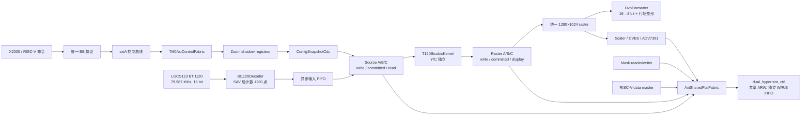

# TI60-239 电子变倍重构与板级问题闭环报告

> 报告范围：从 Codex 会话 `01a05d5b-3b06-7b50-9497-c000adeffcb5` 开始，覆盖后续电子变倍、AXI 控制、HyperRAM 仲裁、帧缓存、DVP 输出及板级调试对话。
>
> Git 基线：`88b011e`（电子变倍全链路 VIO）
>
> 当前终点：`c17322f`（`fix dvp 错位`）
>
> 当前状态：工程已经能够出图；ADV 路稳定，DVP 行边界循环错位也已由最新版本解决。
>
> 说明：本报告同时记录成功方案和失败的中间方案。提交进入历史不等于当时已经完成板级闭环。

## 1. 重构目标与最终结论

本次工作的目标并不是单独“加一个电子变倍模块”，而是把一条原本由临时 UART 控制、双缓冲、分支旁路和层叠仲裁组成的视频链路，重构成可验证、可恢复、可扩展的产品路径：

1. 1280×1024、30 fps、16-bit YUV422 BT.1120 输入能够连续采集；
2. 1×与放大模式使用同一条处理路径，避免两条路径长期行为不一致；
3. ROI 配置通过 RISC-V 的 AXI 控制面提交，并且只在安全边界生效；
4. 源帧和结果帧具有明确所有权，不显示、不处理半帧；
5. 多个 HyperRAM master 之间可以扩展，不再依赖层层嵌套的三口仲裁器；
6. ADV/CVBS 与 DVP 共享同一份完整 raster，但分别满足各自的外部时序契约；
7. 出现故障时，可由 VIO/LA 和定向回归把问题定位到输入、帧提交、计算、访存、raster 或输出支路。

最终闭环不是由某一个“大修复”完成的，而是依次消除了六类相互叠加的问题：

- BT.1120 payload 被误识别为 TRS，导致有效行变短；
- 双缓冲写读追赶，导致正在使用的帧被覆盖；
- final-video 读端在 burst 中途拉低 `RREADY`，再被串行仲裁器放大成写侧饥饿；
- 计算器到 raster writer 的 `ready/valid` 时序错误，每个 burst 边界丢像素；
- DVP 行周期与 X2000 既有接收时序不一致；
- DVP 的 VSYNC 边沿没有落在接收端期望的行消隐区间。

截至 `c17322f`，这些问题分别由计数定帧、源/结果三缓冲、轻量读写解耦仲裁、burst credit、状态级 `valid`、DVP cadence/VSYNC 整形解决。用户的最终板级反馈确认 DVP 问题也已解决。0

## 2. 重构前后对比

| 维度 | 重构前/早期版本 | 当前实现 | 直接收益 |
|---|---|---|---|
| 控制入口 | FPGA 内部 `ElectronicZoomUartController` 直接解析独立命令；与软核控制面并存 | X2000 命令由 RISC-V 统一解析，通过 `axiA` 访问 System/Zoom/Mask 寄存器 | 协议入口统一，后续功能按 AXI 地址扩展 |
| 配置跨时钟域 | ROI 字段可能被独立同步或在数据面直接使用 | `ConfigSnapshotCdc` 以完整快照 + toggle/ack 跨域，并在安全边界确认应用 | 不会出现一次配置中不同字段来自不同版本 |
| 1×模式 | raw bypass 与 zoom/raster 路径并存，需要帧边界切换 | disable 被解释为全幅 ROI，1×和放大都经过 source → bicubic → raster | 消除旁路与处理路径的画质、时序和故障差异 |
| BT.1120 解码 | 有效区内继续搜索 `FFFF 0000 0000 XY`，payload 等于 `FFFF/0000` 时可能误触发 | 识别 SAV 后固定接收 1280 个 active word，有效区由计数器定界 | 全动态范围像素不会截短一行 |
| 插值算法 | 内联的 8 相位/Q16 系数逻辑，phase 8～15 落入 default | 独立的 `T120BicubicKernel`，Y 与 C 分开处理，Q0.10 小数相位 | 复用已验证的 T120 算术语义，避免混合 Y/Cb/Cr |
| 源帧缓存 | A/B 双缓冲；写端可能追上 calculator 正在读的 buffer | A/B/C 三缓冲，区分 write/committed/read 角色，只发布完整帧 | 捕获、待处理和处理中帧互不覆盖 |
| raster 缓存 | A/B 双缓冲；完整帧发布与显示保护能力有限 | A/B/C 三缓冲，区分 write/committed/display 角色 | 写端不会覆盖显示中的帧，显示只切换到已提交帧 |
| HyperRAM 仲裁 | 多级 `AxiShared3Arbiter`，单状态机，读写完全串行 | 参数化 6-slot `AxiSharedFlatFabric`，读/写各最多 1 笔在途，方向独立 | 读响应停顿不再把整个写方向锁死；新增 master 只增加 slot |
| final-video 读 burst | FIFO 快满时可在 burst 中途拉低 `RREADY` | 发 AR 前确认可容纳完整 burst；AR 接受后持续 `RREADY` 到 burst 结束 | 避免半个读 burst 长期占住返回通道 |
| calculator 输出握手 | `output_valid` 尚未对外可见时可能因 `output_ready` 提前前进 | `Z_OUT` 状态本身就是 `output_valid`；仅在真实握手后前进 | raster 每 128 像素停顿时不再丢下一个像素 |
| DVP 输出 | raster 行间 gap 仅 64 cycle；VS 边沿紧贴有效数据 | `LINE_GAP_CYCLES=401`，帧 gap 重新配平；VS 在行消隐内提前拉高、延后拉低 | 恢复 X2000 已调通的 DVP 行/场时序，消除稳定滚动错位 |
| 可观测性 | 只能看到少量模块状态，难区分物理内存、仲裁、帧提交和 FIFO | p49～p59 结构化 VIO + BT/AXI/zoom/raster LA + p60～p63 HyperRAM 完整性 | 可以按帧计数差分和首故障位置逐级定位 |

## 3. 最终架构



数据面遵循三个边界：

- **像素边界**：所有可停顿的模块必须遵守 `valid && ready`；未握手时 payload 与标志保持稳定。
- **burst 边界**：AXI master 发起读 burst 前必须预留完整接收空间；事务 owner 保持到 `RLAST` 或写响应结束。
- **帧边界**：只有完整写入的帧才能从 write 角色发布为 committed；读/显示角色只在安全帧边界切换。

## 4. 实施过程与问题闭环

### 4.1 第一阶段：先建立可观测性，而不是直接猜横纹

起点 `88b011e` 的主要价值是把电子变倍纳入可调试状态：

- 梳理 `BT.1120 decoder → source frame buffer → bicubic → raster buffer → DVP/CVBS`；
- 将遗漏的 `ElectronicZoomRasterBuffer.v` 加入 `ivlab239.xml`，解决 `VERI-1063 unknown module`；
- 为 source capture、calculator、raster writer/reader、AXI 握手和输出选择配置 p49～p57；
- 保留 p59 的端到端帧计数，p60～p63 的最终 HyperRAM 完整性检查；
- `run.bat dual debug` 首次完整通过，基线资源约为 `60510/60800 XLR`。

这一阶段没有证明横纹已经解决。它只是让后续能够回答“帧在哪一级停止增长”和“到底是 FIFO、AXI、物理 HyperRAM还是帧边界”的问题。后续板测也证明，综合和位流成功不能代替图像验收。

### 4.2 第二阶段：恢复 AXI 控制面，并统一命令协议

早期工作树一度又回到旧 UART 端点，甚至 `top.v` 的部分 `axiA` handshake 接成常值。检查重构计划、分支和 stash 后，重新恢复了 AXI 方案，并形成 `efac61a real 重构`：

- 删除 `ElectronicZoomUartController.v`，不再让 FPGA 内部维护第二套电子变倍协议；
- `Ti60AxiControlFabric` 将 RISC-V `axiA` 解码到：
  - System：`0xE100_0000`；
  - Zoom：`0xE101_3000`；
  - Mask：`0xE104_3000`；
- Zoom 寄存器使用 shadow + commit，忙时拒绝新提交并统计 accepted/rejected；
- `ConfigSnapshotCdc` 将 `{enable,left,top,width,height}` 作为 45-bit 原子快照跨到 100 MHz 视频域；
- ack 只在视频模块真正采用新 ROI 的安全边界返回；
- X2000 工具与软核统一为 `BB | len | dalei | zixiang | type | payload | CRC | AA`，CRC 初值与软核 `doCrc()` 一致为 `0x0000`；
- disable 不再切换 raw bypass，而是提交 `(0,0)-(1279,1023)` 的全幅 ROI。

这里解决的是可维护性和一致性：控制面以后增加功能只需新增地址 endpoint 和命令分发，不再复制 UART 状态机。

### 4.3 第三阶段：用 T120 算法语义替换未完整定义的插值器

原 `ElectronicZoomFrameBuffer` 内联了一套 4×4 bicubic 计算，但系数表只明确列出 phase 0～7，实际索引为 4 bit；phase 8～15 会统一落入 default。初期全帧回归还出现首像素 `X`、Y/C 大面积不匹配，说明“能输出一帧”不代表算法和缓存窗口正确。

重构后的处理方式是：

- 抽出 `T120BicubicKernel.v`；
- 保留 T120 的 4×4、Q0.10 小数相位和舍入/裁剪语义；
- 为 Y 和 C 分别例化 kernel，绝不把 `{C,Y}` 当作 16-bit 数值整体插值；
- 由 source frame buffer 负责坐标累加、四行 cache 和窗口排列，kernel 只负责确定的算术；
- 通过 211/211 个整数、边界、相位和随机向量完成 bit-exact 验证；
- 再由 `tb_ezfb_kernel` 验证 `{C=CD,Y=AB}` 的窗口字节序和输出 `{CDAB}`。

这一步把“算法正确性”和“帧 DMA/所有权正确性”拆开验证。前者通过并不意味着后者自动成立，这个边界在后续定位中非常重要。

### 4.4 第四阶段：第一次“鲁棒性修复”反而造成不出图

`4af0bf0` 尝试加入严格帧校验：早 EOF、丢 EOF、意外 SOF和索引越界都丢帧，并提高 raster 预取水位、给 zoom 更高仲裁权重。思路是防止坏帧继续传播，但条件与真实 BT.1120 解码语义没有对齐。

板上表现从横纹变成完全不出图。关键证据是：

- p51 显示 capture active、burst pending，但 `committed_valid=0`；
- `input_pixel_index` 两次采样从 443648 变到 171776，说明每个新 SOF 都在重置采集；
- p59 中 captured/calculated/raster 全为 0；
- 当时 `input_fifo_overflow=0`，所以并不是 FIFO 填满导致的直接丢帧。

代码审计找到了组合原因：

1. 解码器在 active payload 中仍搜索 TRS，像素值 `FFFF` 会被当成同步字起点而丢掉；
2. writer 又要求 EOF 必须精确落在第 `1280×1024` 个像素；
3. 每行一旦少点，整帧都会被严格 EOF 条件拒收；
4. 下一个 SOF 再次清零，于是永远没有 committed frame。

最终修复不是继续添加例外，而是重建输入契约：

- `Bt1120Decoder` 只在消隐区搜索 TRS；识别 active SAV 后，固定输出 1280 个 word；
- active payload 中的 `FFFF`/`0000` 作为普通像素保留；
- writer 以 `input_pixel_index == FRAME_PIXELS-1` 形成帧尾 burst 并提交，不再依赖脆弱的“外部 EOF 必须同周期到达”；
- 提前 SOF或 FIFO overflow 只会使当前帧作废，并在下一帧重新同步，绝不发布半帧。

真实输入约束也被纳入测试：2370 word/line、1125 line/frame、30 Hz，其中 1280×1024 为 active；消隐行使用 V=1 的 `ABAB/B6B6`，有效行使用 `8080/9D9D`。

### 4.5 第五阶段：从双缓冲“冲突指示”升级到真正的帧所有权

早期 `source_buffer_conflict` 只是 debug 位，检测到了风险也不能阻止覆盖。两个 buffer 在持续采集和较慢的整帧计算之间不够表达三种同时存在的角色：

```text
正在写入     最新完整待处理     calculator 正在读取
write        committed          read
```

因此 source 和 raster 都改成 A/B/C 三缓冲：

| 区域 | A | B | C | 单帧跨度 |
|---|---:|---:|---:|---:|
| Source | `0x0100_0000` | `0x0128_0000` | `0x0150_0000` | `0x0028_0000` |
| Raster | `0x0180_0000` | `0x01A8_0000` | `0x01D0_0000` | `0x0028_0000` |

source 侧的 write/committed/read 和 raster 侧的 write/committed/display 始终互斥。新完整帧可以替换尚未消费的 pending 帧，但不能覆盖正在读或正在显示的 buffer。无安全 buffer 时丢弃整帧，比产生一张混合两帧的图更可控。

这是重构计划中 `FREE → CAPTURING → READY → PROCESSING → FREE` 的角色化实现。当前代码没有照抄一个大枚举 FSM，而是用三个 buffer role 和安全选择函数表达同一所有权约束。

### 4.6 第六阶段：真正定位 HyperRAM 写侧饥饿

三缓冲和输入定帧修正后，板上仍出现无图，p59 出现 `input_fifo_overflow=1`。这时不能把“BT.1120 不能反压”当成最终根因：物理源确实没有 ready，但 8192-pixel FIFO 足以吸收短暂停顿，必须继续找下游为什么长期不给写带宽。

LA/VIO 证据最终指向 final-video reader：

- BT.1120 LA 已证明解码输出正常；
- p61/p62/p63 没有发现两条 HyperRAM 物理数据通道错误；
- p60 显示最终视频链仍在持续读帧；
- p56 的当前/历史最坏 read-stall owner 都是 leaf 1，即 final-video；
- `HyperRamVideoBt656` 原实现为 `rready = ST_R_D && !rfifo_full`；
- 32-deep FIFO 在 100 MHz AXI 写入、27 MHz 像素读出时会在 burst 中途变满并撤销 `RREADY`；
- 旧仲裁器停在 `ST_READ` 等 `RLAST`，因此半个读 burst 会阻塞所有后续写请求。

单次最长地址等待约 19.54 μs，而 8192 像素 FIFO 从空到满约需 102.4 μs。这说明不是“一次巨型 stall”，而是反复的小 stall 吞噬了平均服务带宽。

修复分两层：

1. **收掉直接触发点**：`HyperRamVideoBt656` 发 AR 前计算同步读指针和剩余空间，只有 `rfifo_free >= BURST_LEN(16)` 才发起读取；AR 一旦接受，`RREADY` 持续有效直到完整 burst 结束。
2. **去掉架构放大器**：用 `AxiSharedFlatFabric` 取代层叠 `AxiShared3Arbiter`。读和写各自保存 owner，各允许一笔事务在途；共享 `arw` 地址口在读写候选之间仲裁，但 R 和 W/B 通道后续独立推进。

当前全局 fabric 有 6 个平坦 slot：final video、mask reader、UART mask writer、zoom source/calculator、zoom raster、RISC-V CPU。权重保持实时通路的连续 burst 配额，但 round-robin 保证其他 master 不会永久饥饿。以后新增访存模块，只需要扩展 `PORTS`、连接一个 slot 并设定权重，不需要再增加一层仲裁树。

当前实现每个方向最多一笔 outstanding，因此响应一定返回当前方向 owner，不需要 ID remap。这是资源、正确性和扩展性的折中：它解决“读返回阻塞写入”，又避免在已经接近满资源的 Ti60 上实现完整多 outstanding crossbar。

### 4.7 第七阶段：仲裁修复后能出图，但仍有横纹

轻量 1R+1W fabric 通过仿真和 Efinity 后，上板从“不出图”变成“可以出图但有横纹”。这说明共享总线的致命饥饿已经解除，但像素流仍有局部协议错误。

连续五次 p59 采样给出决定性反证：

- source captured 每次增加约 107～113；
- calculator completed 每次增加约 54～56；
- raster committed 只增加 0～1；
- raster display 仍快速增长，实际是在重复显示旧 committed 帧；
- `zoom_input_fifo_overflow=0`；
- `raster_underflow=0`；
- zoom/raster AXI error 均为 0。

同时：

- `p19=0`，最终 PAL FIFO 没有欠载；
- p54 的 raster read FIFO 水位为 223、224、235、234 beats；
- `received_beats - consumed_beats` 与水位完全一致；
- p50/p56 也没有给出持续读返回阻塞。

因此横纹不是 FIFO 不够深，也不是 HyperRAM 带宽仍然不足，而是 calculator → raster writer 之间丢了像素。

原 `Z_OUT` 状态中，`output_valid` 是时序寄存输出，但状态机会在只看到 `output_ready` 时前进。当 raster writer 每收满 128 像素拉低 ready 去写一个 AXI burst 时，下一个像素可能在 valid 真正对外可见前就被跳过。每个 burst 丢一点，打包相位不断移动，EOF 只有偶然与 burst 尾对齐时才能提交，正好解释“计算约 55 帧，raster 只提交 0～1 帧”。

最终实现让 `Z_OUT` 状态本身成为保持寄存器：

```verilog
assign output_valid = (zstate == Z_OUT);
```

坐标、kernel 输出和 SOF/SOL/EOL/EOF 在该状态内保持稳定，仅当 `output_ready` 为 1，也就是真实 `valid && ready` 时才前进。这个写法还移除了第一版修复新增的一组宽输出寄存器，避免 debug 版本超出资源。

### 4.8 第八阶段：ADV 正常而 DVP 行边界稳定滚动

ready/valid 修复后，共享 raster 内容已经正确，ADV 一路正常，但 DVP 图像的行边界会稳定地从上到下循环。这个现象把问题隔离到了 DVP 专用分支：如果 HyperRAM、插值结果或 raster 帧本身错误，ADV 不可能保持正常。

`p15=0` 又排除了两种 DVP FIFO 故障：

- DVP CDC FIFO 没有 overflow；
- 有效行内没有因为取不到下一个字而插入 bubble。

剩余差异是外部时序契约。旧的、已经调通过的 LGCS123 → DVP 路径每行约有 2560 个有效 byte clock 和约 402 个 blank clock；重构后的 raster 原来只配置 64-cycle 行 gap，行周期显著缩短，多余时间被集中放到帧尾。总帧率仍接近 30 fps，但 X2000 看到的每行节拍已经变化，因此行边界稳定滚动。

最终 `c17322f` 做了两部分修复：

1. `ElectronicZoomRasterBuffer` 使用 `LINE_GAP_CYCLES=401`，DVP 端形成约 402 个空白 byte clock；同时将 `FRAME_GAP_CYCLES` 调整为 301269，使

   ```text
   1024 × (2560 + 401) + 301269 = 3,333,333 cycles
   ```

   在 100 MHz 域保持 30.00 Hz 帧周期。

2. `DvpFormatter` 不再让 VSYNC 边沿紧贴有效像素。SOF word 到达 FIFO 头时，利用 SOL prefill 在 HS 仍低的消隐期提前拉高 VS；最后一个有效字节发完后，再延迟 401 cycle 拉低 VS。这样接收端在 HS 低期间看到稳定的场边沿。

新增的 `tb_dvp_formatter_cadence` 检查每行严格 2560 个有效字节、约 395～410 个空白时钟且无 FIFO 错误；`tb_dvp_formatter_frames` 连续发送两帧，检查每帧 VS 之间恰有规定数量的 HS 脉冲、VS 边沿位于消隐期、帧间 VS 保持低。最新板级反馈确认 DVP 错位已经解决。

## 5. 失败方案与为什么失败

### 5.1 把 P&R PASS 当作视频正确

早期版本能通过 Icarus 或 Efinity，并不代表横纹消失。视频问题涉及外部 BT.1120、真实 HyperRAM IP、多个时钟域和接收端时序；这些边界不是一次综合能覆盖的。后续流程改为“模块协议回归 → 完整工程构建 → VIO/LA → 板上图像”的分层验收。

### 5.2 严格依赖外部 EOF

严格 EOF 的初衷是拒绝坏帧，但上游解码器会丢 payload，结果是所有帧都被拒绝。正确方式是先定义可靠的像素计数契约，再以计数完成作为 commit 条件；协议错误用于丢弃与恢复，而不是让多个不可靠标志互相卡死。

### 5.3 只提高 FIFO 水位和仲裁权重

更深 FIFO和更高权重可以缓解短暂拥塞，但不能修复 burst 中途撤销 `RREADY`，也不能修复单状态机把读阻塞传播到写方向。它们是性能参数，不是协议正确性的替代品。

### 5.4 直接照搬两套完整 AXI crossbar

第一次参考 T120 时使用了两套完整 Alex-Forencich `axi_interconnect`，分别做读和写，再合并到共享地址口。方向概念正确，但实现对于 Ti60 太重：debug 构建达到 `61250/60800 XLR`，P&R 失败。

真正应复用的是 T120 的“读写方向解耦”原则，而不是完整交叉开关的规模。最终 flat fabric 只保留本项目需要的 owner、响应路由和加权轮转。

### 5.5 为了省资源退回单事务 flat arbiter

完整 crossbar 超资源后，曾把它改成轻量 N-port 单事务状态机。资源回到约 `60546 XLR`，但读写仍完全串行，与旧 `AxiShared3Arbiter` 的关键语义相同，因此并没有解决已经确认的功能缺陷。最终版本在保持轻量的同时，必须保留独立 read owner 和 write owner。

### 5.6 用宽寄存器修 ready/valid

ready/valid 的第一版修复增加了一组宽输出保持寄存器，使 debug 构建超出约 106 个逻辑块。最终用 `Z_OUT` 状态直接表达 valid，既满足稳定性又减少资源。这说明在高利用率 FPGA 上，协议修复也要考虑状态编码和数据保持方式。

### 5.7 把两颗 HyperRAM误解为两个独立读写 bank

当前 dual HyperRAM IP 对上层仍暴露一套共享 `arw/W/R/B`，两颗器件用于扩宽数据接口，不是“一颗读、一颗写”的两个独立控制器。片内真双口 BRAM适合 FIFO和行缓存，但 Ti60 全部约 2.6 Mbit，而一帧 1280×1024×16 bit 已约 20.97 Mbit，无法承担整帧缓存。因此本次继续使用 HyperRAM是合理的；需要修复的是上层调度和所有权。

### 5.8 调试核本身也会制造工程问题

新增 LA 后曾出现生成的 `edb_top` 端口与 `top.v` 不一致；原因是 debug 配置生成路径使用了错误/过期文件。另一次 `gen_debug.bat` 还把 Efinity 路径写死为 `C:\Efinity\2026.1`，而机器实际安装在 `D:\Efinity`。最终遵循仓库公开入口 `run.bat`，并把调试配置、生成文件和工程源清单作为同一版本检查。

## 6. 资源问题的额外闭环

重构期间还遇到一次与视频逻辑无关但会阻塞位流生成的资源问题：`UartMachineForwarder` 的 4144-bit 双缓冲被综合成数千个 FF/LUT。按用户建议直接例化一块 `EFX_RAM10` 作为 1024×8 简单双口存储后：

- 模块 FF 约从 4325 降至 173；
- LUT 约从 4008 降至 253；
- 使用 1 个 RAM10；
- 保留帧校验、双缓冲和串口转发行为；
- UART 回归结果为 `PASS good=3 bad=1 fwd=25`。

这项修改只解决 P&R 容量，不在视频像素链路内，因此从未被当作横纹修复。

## 7. 验证证据与边界

### 7.1 当前 HEAD 重新执行的定向回归

| 测试 | 当前结果 | 覆盖内容 |
|---|---|---|
| `tb_bt1120_decoder_counter` | PASS | SAV 后按配置宽度接收 payload，`FFFF/0000` 不截断有效行 |
| `tb_axi_shared_flat_fabric` | PASS | 响应归路、读写解耦、加权 round-robin |
| `tb_video_read_credit` | PASS | 发 AR 前整 burst 空间准入、burst 内持续接收 |
| `tb_zoom_output_handshake` | PASS | ready 在 burst 边界下降时不丢像素，标志随真实握手推进 |
| `tb_dvp_formatter_cadence` | PASS | 2560-byte 有效行、约 402-cycle 消隐、无 DVP FIFO 错误 |
| `tb_dvp_formatter_frames` | PASS | 两帧之间 VS/HS 数量和边沿位置正确 |

历史回归还包括：

- T120 bicubic kernel：211/211 vectors bit-exact；
- source burst packing：bit-exact；
- FIFO overflow 后坏帧丢弃与下一帧恢复：PASS；
- 真实 2370×1125 BT.1120 连续流、payload 含 `FFFF/0000`、0/100 ns AXI latency：PASS；
- 完整 1280×1024 帧回归：`captured=2, zoomed=1`，Y/C mismatch 为 0；
- 原加权仲裁 starvation 回归：权重 1/1/4 时长期 grant 为 25/25/100。

### 7.2 最终 Efinity 构建

最终 debug 构建目录：

`runs/Ti60F225C4_dual_debug_init/20260904_002632`

结果：

| 项目 | 结果 |
|---|---:|
| map / interface / pnr / pgm | 全部完成 |
| Bitstream | `outflow/ivlab239.bit` 已生成 |
| XLR | `60395 / 60800`，约 99.33% |
| RAM10 | `218 / 256` |
| DSP48 | `152 / 160` |
| 200 MHz `hbramClk` setup slack | `+0.516 ns` |
| 160 MHz `clk_scaler` setup slack | `+0.287 ns` |
| 最小最终 hold slack | `+0.026 ns` |

资源仍然很紧。以后新增 VIO、LA、完整 crossbar 或宽保持寄存器前，必须先做资源预算。

### 7.3 板级证据

板级调试形成了以下证据链：

1. p61/p62/p63 为 0：最终 HyperRAM 完整性监测未发现物理数据错配；但它不覆盖所有电子变倍地址区，所以不能单独证明 zoom buffer 正确。
2. p19 为 0：最终 PAL 读 FIFO没有欠载。
3. p15 为 0：DVP CDC 没溢出，有效行内没有 serializer bubble。
4. p54 高水位且计数自洽：raster read FIFO没有欠载。
5. p59 的 stage counter 差分暴露了 calculator 与 raster commit 的异常比例，从而定位 ready/valid 丢点。
6. ADV 正常而 DVP 错位：把最后的问题隔离到 DVP 专用时序整形。
7. 最新版本上板后，用户确认 DVP 问题也已经解决。

仿真中的 HyperRAM是功能 AXI memory model，不能实例化加密的 `dual_hyperram_ctrl.sv`。因此仿真证明 RTL/AXI 协议，Efinity 证明可综合、可布局和静态时序，只有板测证明真实 HyperRAM IP、I/O、PVT与外部接收端共同工作。

## 8. 当前方案为何更可扩展

### 8.1 控制面扩展

新功能按照“AXI 地址 endpoint + shadow/commit + snapshot CDC”添加，不需要再设计新的串口帧状态机。软件能够读 capability/status，并知道命令是 accepted、pending 还是 rejected。

### 8.2 访存 master 扩展

`AxiSharedFlatFabric` 的接口是参数化 flat vector。新增 master 时：

1. 增加一个 slot；
2. 连接 A/W/B/R 五组信号；
3. 设置该 slot 的 weight；
4. 用协议测试验证响应回到正确 owner；
5. 用带宽和最大等待计数验证实时性。

无需改变其他 master 的局部仲裁层级。当前 1R+1W 架构不是最大吞吐方案，但已经隔离读、写方向的阻塞传播；只有实测吞吐再次不足时，才有理由升级为多 outstanding + ID 路由。

### 8.3 视频模块扩展

所有视频模块使用统一 `{pixel, valid, ready, sof, eof, sol, eol}` 契约。新增处理模块必须保证：

- `valid && !ready` 时 payload/标志保持；
- 只在 `valid && ready` 时移动坐标和帧状态；
- 半帧不能变成 committed frame；
- 外部持续源无法反压时，overflow 必须使整帧作废并可恢复；
- 输出端的内容契约与时序契约分别验证。

### 8.4 输出支路扩展

ADV 与 DVP共享同一 committed raster，所以内容只有一份真相；每个输出支路只负责自己的重采样或协议时序。以后新增 HDMI、MIPI 或网络输出时，应从统一 raster 消费，而不是重新解码 BT.1120 或维护第二套 zoom 状态。

## 9. 后续建议与剩余风险

当前已经完成“能出图且 DVP/ADV正常”的目标，但产品化仍建议保留以下门槛：

1. **长稳测试**：在 200 MHz HyperRAM、不同温度/电压和连续 ROI切换下运行数小时，记录 p59～p63 是否回卷前增长。
2. **带宽预算**：为每个 master 记录平均/峰值带宽和最大等待，新增 master 前做预算，而不是上板后再靠调权重。
3. **帧率验收**：区分输入 30 fps、calculator 处理帧率和 display 重复帧率；允许重复显示最新完整帧，但禁止显示半帧。
4. **CDC 审计**：继续坚持 snapshot/toggle/ack；不要把多位配置重新改回独立双触发同步。
5. **DVP 接口文档化**：固定记录 X2000 使用的是 `dvp_valid` 作为外部 HS、VS 边沿位于 blanking 的实际约定，防止以后按信号名误接。
6. **资源守门**：debug 版只剩约 405 XLR，且 DSP 使用 152/160；新增算法核或探针前先查看 hierarchy resource report。
7. **验证自动化**：把本报告列出的六项快速回归封装为统一脚本，并在 `run.bat` 前执行，减少协议回归到板上才暴露的概率。

## 10. 关键提交与会话索引

### 10.1 Git 提交

| 提交 | 作用 | 当时状态 |
|---|---|---|
| `88b011e` | 全链路 VIO、补入 RasterBuffer source | 建立可观测性，未证明横纹解决 |
| `05a10e8` | 电子变倍重构计划、AXI/control/CDC、T120 kernel 与测试资产 | 架构和验证基础 |
| `1630271` | 删除错误放入本仓库的软核代码 | 清理工程边界 |
| `efac61a` | 恢复 AXI 控制面、移除旧 UART endpoint、统一数据路径 | “real 重构”，仍未板级闭环 |
| `eb675de` | 更新统一 BB 协议说明与指令集 | 软件/FPGA协议对齐 |
| `0511e0c` | `UartMachineForwarder` 改用 EFX_RAM10 | 解决资源超限，不是视频修复 |
| `4af0bf0` | 严格帧校验、双缓冲保护、预取和加权仲裁 | 中间 bug 版，导致帧无法提交 |
| `4ff7e6b` | BT.1120 计数定帧、三缓冲、flat 1R+1W、burst credit、ready/valid 修复、回归与调试 | 主体功能闭环，板上已经出图 |
| `c17322f` | DVP cadence 和 VSYNC 边沿修复，两项 DVP 测试 | 最终 DVP 错位闭环 |

`641e06e` 位于单独的 `origin/電子變倍-bug` 分支，保存过一版大规模 bug/debug 工作，但不是当前 `rebuild` 主线终点，不能将其实现细节当作最终架构。

### 10.2 已检索的会话

| 会话 ID | 主要内容 |
|---|---|
| `01a05d5b-3b06-7b50-9497-c000adeffcb5` | 起点：电子变倍路径分析、VIO、工程 source 修复 |
| `01a0612e-31d3-7043-9da0-2b8d16633c63` | T120 kernel 适配与 211-vector 验证 |
| `01a0619d-5dc3-73e1-aa70-dc88d5a3224b` | 重构计划评估、帧级 cocotb 初期失败与诊断 |
| `01a0625b-32c9-7c22-97cb-0522afdcfe02` | 恢复 AXI 控制面、BB 协议迁移、全帧失配诊断 |
| `01a0636f-a9bc-7ac2-b390-4d3a5ea3b841` | 资源修复、板上横纹/不出图、BT.1120 与三缓冲闭环 |
| `01a06373-6c2f-7d92-9374-fffaec4f3017` | P&R 容量报错的短会话；仅启动排查，无独立技术结论 |
| `01a065f8-28bc-7b73-8b8e-36015790726b` | LA/VIO、final-video RREADY、仲裁架构和资源取舍 |
| `01a06728-8576-7cc3-b81a-8195c39495ce` | 空白/失败续接会话，无新增实现 |
| `01a06729-34b1-7a60-bd6a-5f308b962609` | 1R+1W 实现、出图、ready/valid 横纹和 DVP 问题定位 |
| `01a067bf-4cd2-76d1-8e7e-5278ce8206d6` | 失败重试会话，无新增实现 |

### 10.3 当前实现文件索引

| 文件 | 当前职责 |
|---|---|
| [`src/top.v`](../src/top.v) | 控制 CDC、统一视频路径、六个 HyperRAM slot、DVP/ADV 分支集成 |
| [`src/input/Bt1120Decoder.v`](../src/input/Bt1120Decoder.v) | BT.1120 TRS 获取与 active payload 计数定帧 |
| [`src/scaler/ElectronicZoomFrameBuffer.v`](../src/scaler/ElectronicZoomFrameBuffer.v) | 输入 FIFO、source 三缓冲、四行 cache、ROI 坐标与输出握手 |
| [`src/scaler/T120BicubicKernel.v`](../src/scaler/T120BicubicKernel.v) | Y/C 独立的 4×4 Q0.10 bicubic 算术 |
| [`src/scaler/ElectronicZoomRasterBuffer.v`](../src/scaler/ElectronicZoomRasterBuffer.v) | raster 三缓冲、预取、确定性 1280×1024 输出 cadence |
| [`src/memory/AxiSharedFlatFabric.v`](../src/memory/AxiSharedFlatFabric.v) | 参数化平坦 master 仲裁、1R+1W owner 和响应路由 |
| [`src/memory/HyperRamVideoBt656.v`](../src/memory/HyperRamVideoBt656.v) | final-video 帧 DMA、读 burst credit 与完整性监测 |
| [`src/dvp/DvpFormatter.v`](../src/dvp/DvpFormatter.v) | 16→8-bit 串行化、SOL prefill 与 VSYNC 消隐期整形 |
| [`src/control/Ti60AxiControlFabric.v`](../src/control/Ti60AxiControlFabric.v) | System/Zoom/Mask AXI 地址译码与 endpoint 汇聚 |
| [`src/common/ConfigSnapshotCdc.v`](../src/common/ConfigSnapshotCdc.v) | 多位配置快照的 toggle/ack 跨时钟提交 |
| [`debug_profile.json`](../debug_profile.json) | VIO/LA 探针布局和名称 |
| [`sim/tb_axi_shared_flat_fabric.v`](../sim/tb_axi_shared_flat_fabric.v) | flat fabric 方向解耦、路由与公平性测试 |
| [`sim/tb_zoom_output_handshake.v`](../sim/tb_zoom_output_handshake.v) | calculator → raster 边界握手回归 |
| [`sim/tb_dvp_formatter_cadence.v`](../sim/tb_dvp_formatter_cadence.v) | DVP 行有效长度与 blanking cadence 测试 |
| [`sim/tb_dvp_formatter_frames.v`](../sim/tb_dvp_formatter_frames.v) | DVP 多帧 VS/HS 合同测试 |

## 11. 关键概念与设计原理

本节将重构过程中容易混淆的几个概念整理为书面问题。相关结论不仅用于解释当前实现，也可作为后续扩展访存 master、修改视频时序或审查 AXI 协议时的设计依据。

### 11.1 HyperRAM 不支持物理同时读写，读写分离仲裁器解决了什么问题？

**问题：** HyperRAM 的 DQ 是双向复用总线，同一时刻只能进行读传输或写传输。既然物理器件不能同时读写，为什么工程仍要将读、写仲裁分离，并允许 `1R+1W outstanding`？

**结论：** 读写分离仲裁器不会、也不可能把 HyperRAM 变成物理全双工存储器。它解决的是上层 AXI 事务之间不必要的阻塞传播，使读事务和写事务能够分别进入控制器、分别保存 owner，并由 HyperRAM 控制器按照物理总线能力顺序执行。

HyperRAM 的物理数据传输仍然是半双工的：

```text
写阶段：FPGA ── DQ ──> HyperRAM
读阶段：FPGA <── DQ ── HyperRAM
```

当前 Efinity HyperRAM 控制器对上层暴露一套共享 `ARW` 地址通道，并使用 `write` 属性区分读地址与写地址；与此同时，W、B、R 数据/响应通道和内部 FIFO 是分开的。因此应当区分两个层次：

| 层次 | 是否可同时存在读写 | 实际含义 |
|---|---|---|
| HyperRAM DQ 物理传输 | 否 | 一个时刻只能传读数据或写数据，需要总线换向 |
| AXI/控制器事务层 | 可以逻辑重叠 | 读请求和写请求可分别被接受、排队和记录 owner |

旧 `AxiShared3Arbiter` 使用一个 `IDLE/READ/WRITE` 状态机。一旦某个读地址被接受，状态机会等待该事务的 `RLAST` 完成后才允许任何写地址进入。若读客户端撤销 `RREADY`，影响就会从该客户端扩散到整个写方向：

```text
final-video 读地址被接受
        ↓
仲裁器进入 READ 并等待 RLAST
        ↓
final-video 因 FIFO 满而撤销 RREADY
        ↓
读事务无法结束，仲裁器不能回到 IDLE
        ↓
zoom source writer 的写请求无法进入控制器
        ↓
BT.1120 输入 FIFO逐渐溢出，完整帧无法提交
```

新 `AxiSharedFlatFabric` 分别保存：

```text
read_busy  + read_owner   // 保持到最后一个 R beat 握手
write_busy + write_owner  // 保持到所有 W beat 和 B 响应完成
```

共享 `ARW` 地址口每个周期仍只选择一个读地址或写地址，但一笔读事务处于返回阶段时，写方向仍可在后续周期提交地址和数据；写请求进入控制器 FIFO 后，再等待物理 HyperRAM 调度。物理执行可能仍是“读 burst → 总线换向 → 写 burst”，但外层 fabric 不再人为要求“读客户端完全消费完返回数据以后，写请求才能出现”。

因此 `1R+1W outstanding` 的准确含义是：

- fabric 最多保存一笔尚未完成的读事务；
- fabric 最多保存一笔尚未完成的写事务；
- 两者可以在逻辑上同时存在；
- R 始终返回 `read_owner`，B 始终返回 `write_owner`；
- 因为每个方向只有一个 owner，不需要复杂的 AXI ID 重映射；
- HyperRAM DQ 仍由控制器串行调度，不会发生物理同时读写。

这项改动的主要收益不是提高理论峰值带宽，而是消除队头阻塞、利用控制器已有缓冲能力，并保证某个读客户端的反压不会直接饿死所有写客户端。

此外，仲裁器解耦必须与 master 侧协议修复配合。`HyperRamVideoBt656` 现在只有在读 FIFO能够容纳完整 16-beat burst 时才发出读地址；地址被接受后持续拉高 `RREADY`，直到完整 burst 接收结束。前者减少阻塞发生的概率，后者则从架构上限制阻塞的传播范围。

### 11.2 Raster 在本工程中指什么？

**问题：** 报告中的 raster、raster buffer、raster writer 和 raster reader 分别表示什么？

**结论：** Raster 在本工程中是按照固定二维坐标顺序和固定行场节拍组织的完整像素帧。它不是 bicubic 插值算法，而是插值结果的完整帧存储及确定性扫描输出形式。

电子变倍 calculator 的输出是可停顿的数据流。它需要读取四行源图、等待 HyperRAM、执行插值，并在 raster writer 写 AXI burst 时接受反压。因此 calculator 即使按正确顺序生成像素，也不能保证像素之间始终没有空隙。这种数据流不适合直接驱动要求固定节拍的 DVP 或 ADV/CVBS 接口。

`ElectronicZoomRasterBuffer` 在两类时序之间建立隔离：

```text
Bicubic calculator
        │ 非连续、可反压的像素流
        ▼
Raster writer
        │ 写满一幅完整 1280×1024 图像
        ▼
HyperRAM raster A/B/C 三缓冲
        │ 只发布 committed frame
        ▼
Raster reader
        │ x=0...1279、y=0...1023 的确定性扫描流
        ├────────> DVP formatter
        └────────> ADV/CVBS pipeline
```

各部分职责如下：

| 部分 | 职责 |
|---|---|
| Raster writer | 接收 calculator 的 `valid/ready` 像素流，打包为 AXI beat/burst并写入当前 write buffer |
| Raster triple buffer | 隔离 write、committed 和 display 三种帧角色，防止半帧或混合帧被显示 |
| Raster reader | 预取 committed frame，并按照固定 X/Y、SOF/SOL/EOL/EOF 和行场空白输出 |
| DVP/ADV 分支 | 消费同一份 raster 内容，分别完成自己的接口格式和时序适配 |

因此 raster buffer 同时完成三项功能：

1. **帧完整性保护**：只有最后一个像素和对应 AXI 写入完成后，整帧才能成为 committed frame。
2. **速率解耦**：calculator 可以间歇地产生像素，输出接口仍能按固定扫描节拍读取上一幅完整帧。
3. **输出统一**：1×和放大模式都形成相同的 1280×1024 raster，DVP 与 ADV 不再分别维护 raw/zoom 图像源。

当前 raster reader 每行输出 1280 个 16-bit YUV422 word。DVP formatter 将每个 word 串行化为两个 8-bit byte，因此一行对应 2560 个有效 DVP byte clock；随后插入约 402 个空白 clock。1024 行结束后再插入帧空白，使总周期保持约 30 fps。

可以将两类模块的关系概括为：

> Bicubic calculator 决定“每个输出像素的数值是什么”；RasterBuffer 决定“哪一幅完整图像以什么坐标顺序和行场节拍被播放”。

### 11.3 AXI burst 是什么？

**问题：** 为什么 source、raster 和 final-video DMA 不按单个像素访问 HyperRAM，而要组织 AXI burst？

**结论：** Burst 是由一次地址请求描述的一组连续数据传输。它将命令、地址和 HyperRAM 初始访问延迟均摊到多个数据 beat 上，是获得有效帧存带宽的基本机制。

AXI 中，一次 `VALID && READY` 数据握手称为一个 beat。当前 HyperRAM AXI 数据宽度为 128 bit：

```text
1 beat = 128 bit = 16 byte
1 YUV422 pixel = 16 bit = 2 byte
1 beat = 8 pixel
```

以当前常用的 16-beat burst 为例：

```text
16 beat × 16 byte/beat = 256 byte
256 byte ÷ 2 byte/pixel = 128 pixel
```

读 burst 的基本过程是：

```text
ARW/AR：提交起始地址、LEN、SIZE、BURST
R0
R1
...
R15 + RLAST
```

写 burst 的基本过程是：

```text
ARW/AW：提交起始地址、LEN、SIZE、BURST
W0
W1
...
W15 + WLAST
B：返回整笔写事务的完成响应
```

如果每个 2-byte 像素都单独发送地址，HyperRAM 需要反复接收命令、地址并支付初始访问延迟，有效数据占总线时间的比例会非常低。使用 burst 后，一次地址开销可换取连续 256 byte 数据传输，显著提高有效带宽。

Burst 同时带来一项协议责任：master 发出读 burst 前必须为 `ARLEN+1` 个返回 beat 预留空间。否则 FIFO 在 burst 中途变满并撤销 `RREADY`，就可能长时间占用返回通道。本工程的 `tb_video_read_credit` 正是用于验证这一约束。

### 11.4 AXI outstanding 是什么？

**问题：** 一笔 AXI 事务在什么阶段被称为 outstanding？它与 burst 有什么区别？

**结论：** Outstanding 表示地址请求已经被 slave 接受，但对应事务尚未完整结束。Burst 描述“一笔事务包含多少个连续数据 beat”，outstanding 描述“这笔事务当前是否仍在系统中等待数据或响应”。

对于读事务：

```text
ARVALID && ARREADY
        ↓
读事务成为 outstanding
        ↓
若干 RVALID && RREADY
        ↓
最后一次 RVALID && RREADY && RLAST
        ↓
读事务完成
```

对于写事务：

```text
写地址被接受
        ↓
写事务成为 outstanding
        ↓
所有 W beat，包括 WLAST，被接受
        ↓
BVALID && BREADY
        ↓
写事务完成
```

可以使用“工单”进行类比：

```text
burst       = 一张工单要求连续搬运多少箱数据
outstanding = 工单已经接收，但尚未全部执行并回执
```

标准 AXI 可以允许同一方向存在多笔 outstanding，并依靠 ID 区分响应属于哪一笔事务。完整支持该能力需要保存多个 owner、顺序信息和 ID 路由，资源开销较大。当前工程选择每个方向最多一笔，即 `1R+1W`：既允许读、写逻辑重叠，又能直接用方向 owner 路由响应，适合资源已经接近满载的 Ti60。

### 11.5 为什么该视频工程必须使用 burst 和 outstanding？

本工程同时具备大数据量、多 master 和实时输入三个特征。

首先，一幅原始帧的数据量为：

```text
1280 × 1024 × 2 byte = 2,621,440 byte ≈ 2.5 MiB
2.5 MiB × 30 fps ≈ 75 MiB/s
```

75 MiB/s 只是一条单向、单次帧流的有效数据量。实际处理至少涉及：

```text
BT.1120 输入写 source frame
calculator 读 source frame
calculator 写 raster frame
DVP/ADV 读 raster frame
CVBS final-video frame DMA继续读写
```

因此实际 HyperRAM 总流量远高于 75 MiB/s。若不使用 burst，命令和访问延迟会吞掉大量总线时间。

其次，当前有六类 master 共享一套 HyperRAM控制器：

```text
final-video DMA
mask reader
UART mask writer
zoom source/calculator
zoom raster
RISC-V CPU
```

仲裁器必须保存事务 owner，保证 W 数据不被其他写 master 插入，R/B 响应返回正确的请求者，并通过加权 round-robin 控制最大等待时间。

最后，BT.1120 是外部持续输入，没有物理 backpressure。内部 FIFO只能吸收有限时间的存储停顿；如果 source writer 长期拿不到服务，FIFO 最终一定溢出。因此本工程需要形成一组配套机制：

| 机制 | 解决的问题 |
|---|---|
| Burst | 降低每个像素的地址与访问开销，提高连续帧搬运效率 |
| Outstanding | 在事务等待数据/响应期间保留状态，并允许另一方向继续推进 |
| Read/write owner | 确保 R/B 响应回到正确 master |
| Weighted round-robin | 为实时通路提供连续服务，同时避免其他 master 永久饥饿 |
| FIFO burst credit | 防止读 burst 进行到一半因接收空间不足而停住 |
| 三缓冲 | 即使处理速率和显示速率不同，也只交换完整帧 |

因此，burst 和 outstanding 并不是为了使用复杂 AXI 特性而额外引入的概念，而是由整帧数据规模、HyperRAM 访问特性、多客户端共享和不可反压的视频输入共同决定的。

## 12. 总结

这次重构最重要的结果，不只是加入了电子变倍，而是把“图像是否正确”拆成了可独立验证的协议层次：输入定帧、帧所有权、AXI burst、共享访存、流握手和输出时序。

最终方案选择了适合 Ti60 资源条件的折中：完整帧继续放在大容量、低引脚的双 HyperRAM；片内 RAM用于 FIFO和行缓存；共享总线使用参数化、轻量的方向解耦 fabric；source/raster 使用三缓冲保证完整帧；所有输出共享同一 raster，再由支路适配 DVP 或 ADV 的外部契约。

更关键的是，调试过程建立了一套以后可以复用的方法：先用阶段计数和 sticky error 排除大类问题，再用握手/owner 波形确认机制，最后以定向回归、完整构建和板测分别验收。这样新增访存 master 或视频模块时，不需要重新从“横纹到底是哪一级”开始猜。
